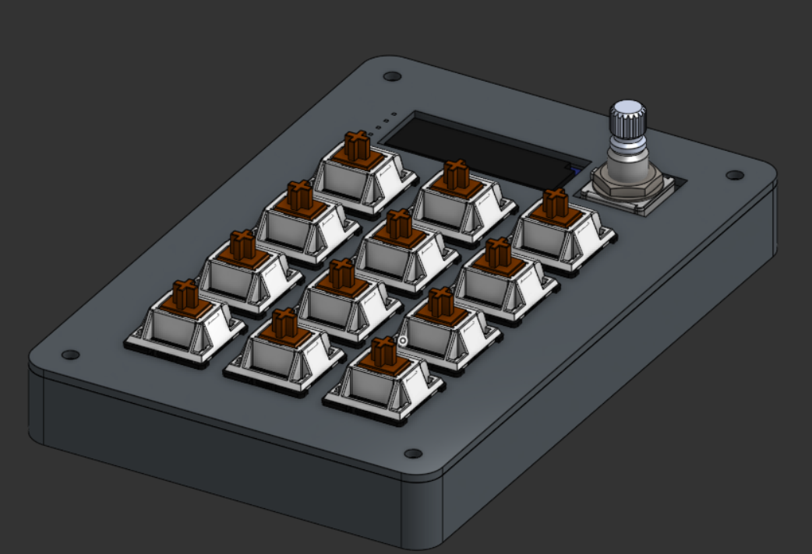
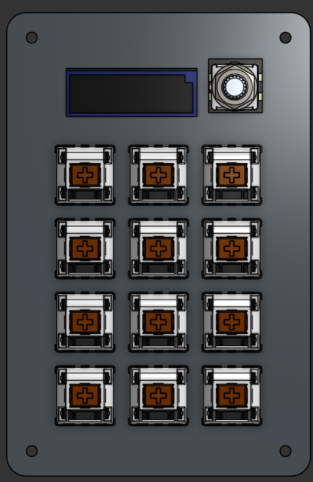
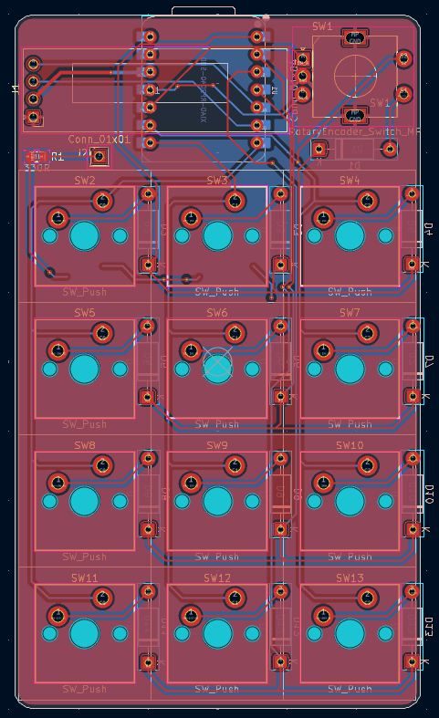
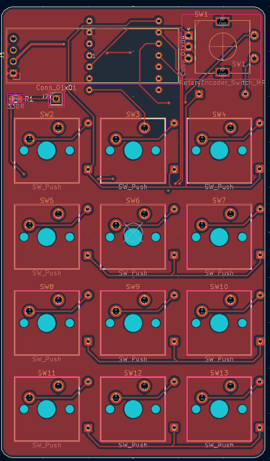
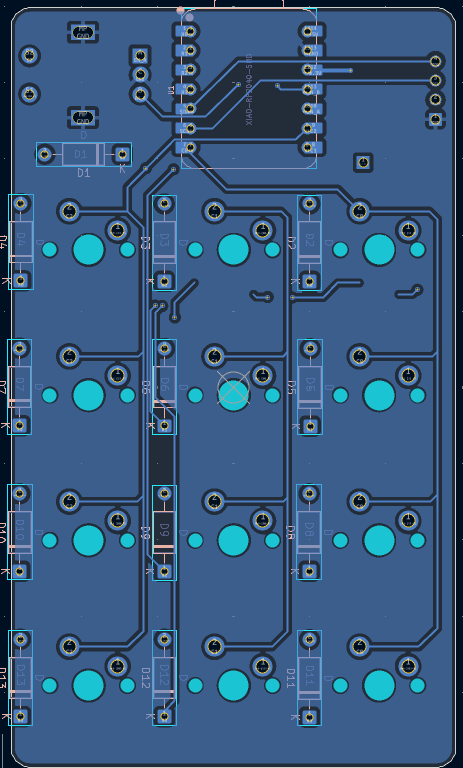
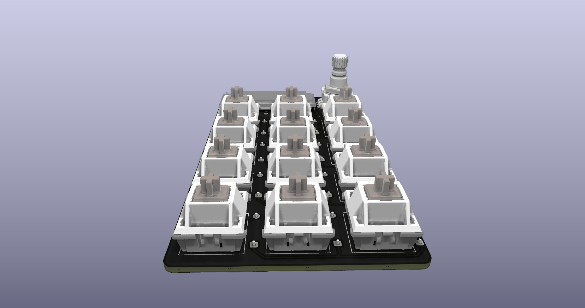
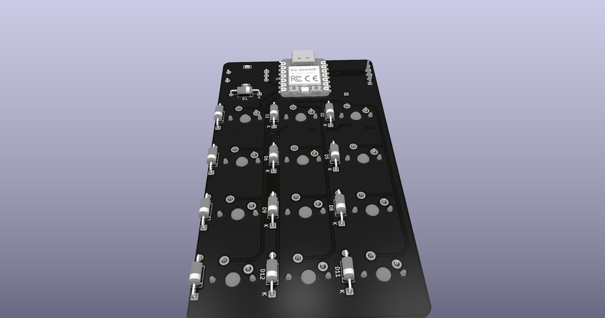
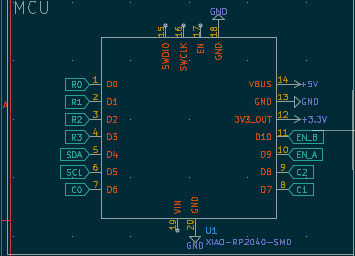
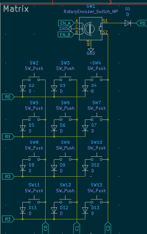
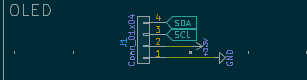

# StarPad

A macropad I made for Stardance!

Features:
- 3x4 MX Switches (not hotswappable :( )
- EC11 Rotary Encoder w/SW
- RP2040-based MCU
- 0.91" OLED
- Type-C
- Open-Source Code and easily programmable!

[Stardance Project](https://stardance.hackclub.com/projects/16496) - [OnShape Project Files](https://cad.onshape.com/documents/bc5e61442675af7e5ac7147f/w/1eb3fd02546ed24d229f4e8a/e/249d99ecdffd48a6fc2d6ed9?renderMode=0&uiState=6ae5d8e905ffe80012a7790f) - [QMK FW Fork](https://github.com/Aahil78/qmk_firmware_starpad) - [KiCanvas Link](https://kicanvas.org/?repo=https%3A%2F%2Fgithub.com%2FAahil78%2FStarPad%2Ftree%2Fmain%2Fsrc)

---
## Pictures

### CAD:

### PCB:

### Schematic:

